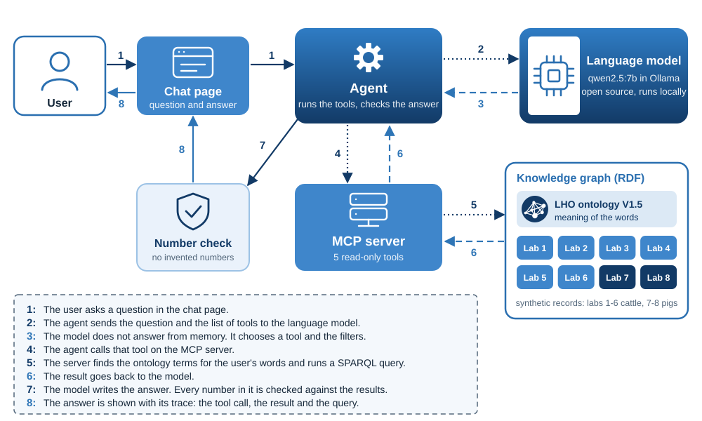

# LHO knowledge-graph assistant

Ask a question about livestock health data in plain language. The answer comes from a knowledge graph, not from the memory of a language model.

> **All data in this repository are synthetic.** Every record is invented by a script (`src/lho_demo/generate_data.py`, fixed seed). Only the structure follows the ontology. No real laboratory data were used.

## In short

- **What it is:** an MCP server with five read-only tools on an RDF knowledge graph, an agent that lets an open-source language model use those tools, and a chat page.
- **The graph:** the [Livestock Health Ontology](https://bioportal.bioontology.org/ontologies/LHO) (LHO V1.5) plus 14,800 synthetic diagnostic test records from eight laboratories (six cattle, two pig).
- **Why the ontology matters:** the user can say "bacteria", "kweek" or "Bovine orthopneumovirus". None of these words is a value in the data; the ontology tells the tools what they mean.
- **How wrong answers are limited:** the model never writes a query, every number in an answer must come from a tool result, and each answer shows the query behind it.
- **Result:** 39 of 40 test questions correct with `qwen2.5:7b`, running locally on a laptop without a GPU.
- **Start it:** `docker compose up`, then open http://localhost:8000.

## How it works



## Example

```
Question: What is the positivity rate of bacterial pathogens in beef cattle?

  tool: test_statistics(pathogen="bacterial", breed="beef")
    -> {"filters": {"pathogen": "Pathogenic Bacterium", "breed": "Beef"},
        "tested": 2291, "positive": 635, "positivity_percent": 27.7}

Answer: 27.7% of the tests for bacterial pathogens in beef cattle were positive (635 of 2,291).
```

The server resolved "bacterial" to the ontology class Pathogenic Bacterium and counted every pathogen that belongs to it.

## Run it

### With Docker

Requirement: [Docker](https://www.docker.com/products/docker-desktop/) with about 8 GB of memory available to it.

```bash
git clone https://github.com/sabanoor8867/lho-mcp-demo.git
cd lho-mcp-demo
docker compose up
```

Then open http://localhost:8000. Three containers start: Ollama, a one-off job that downloads the language model (4.7 GB, first time only), and the application. Stop with Ctrl+C.

- Tool tests inside the container: `docker compose run --rm app pytest -q`
- A smaller model: `LHO_MODEL=llama3.2:3b docker compose up`

### Without Docker

Requirements: Python 3.11 or newer, [Ollama](https://ollama.com), and about 8 GB of free memory for the default model. Works on Windows, macOS and Linux; all paths are relative to the repository.

```bash
git clone https://github.com/sabanoor8867/lho-mcp-demo.git
cd lho-mcp-demo
python -m venv .venv
```

Activate the environment:

| System | Command |
|---|---|
| Windows, PowerShell | `.venv\Scripts\Activate.ps1` |
| Windows, Git Bash | `source .venv/Scripts/activate` |
| macOS and Linux | `source .venv/bin/activate` |

Install and run:

```bash
pip install -e ".[dev]"
ollama pull qwen2.5:7b                 # the default model, 4.7 GB

pytest -q                              # 34 tests of the tools, no model needed
lho-ask "How many BRSV tests were positive in 2024?"
lho-chat                               # chat page on http://127.0.0.1:8000
```

The first answer takes longer, because the model is loaded into memory.

Other commands: `lho-generate-data` rebuilds the synthetic data (same result every time). `lho-server` starts the MCP server alone, for use from another MCP client (`lho-server --http` for HTTP).

| Setting | Default | Meaning |
|---|---|---|
| `LHO_MODEL` | `qwen2.5:7b` | Any Ollama model that supports tool calling |
| `LHO_ENABLE_SPARQL` | off | `1` adds the `run_sparql` tool |
| `LHO_PORT` | `8000` | Port of the chat page |

## What is in the repository

| Part | Location | What it does |
|---|---|---|
| Synthetic data | `data/synthetic/` | One RDF file per laboratory, and the same records as `records.csv` |
| Data generator | `src/lho_demo/generate_data.py` | Writes the 14,800 invented records (12,000 cattle, 2,800 pig) |
| Ontology | `ontology/` | LHO V1.5 |
| Knowledge graph | `src/lho_demo/graph.py` | Loads ontology and data, resolves words to ontology terms, builds and runs SPARQL |
| MCP server | `src/lho_demo/server.py` | Offers the tools to any MCP client |
| Agent | `src/lho_demo/agent.py` | Lets the model call tools until it can answer; checks the numbers in the answer |
| Chat page | `src/lho_demo/web.py` | One web page; shows the tool calls and the SPARQL behind each answer |
| Tests | `tests/` | 34 tests of the tools |
| Evaluation | `eval/` | 40 questions with known answers, the scorer, and the result files |

### The tools

| Tool | Use |
|---|---|
| `graph_overview` | What the graph contains and the valid values of each dimension |
| `test_statistics` | Tested, positive, negative and positivity, with filters and grouping |
| `list_values` | The values of one dimension with their counts |
| `search_terms` | Find an ontology term by name or synonym, in any language |
| `describe_term` | Definition, parent classes, synonyms and relations of a term |
| `run_sparql` | Read-only SPARQL for experts; off unless `LHO_ENABLE_SPARQL=1` |

## Design decisions

1. **The model never writes SPARQL or IRIs.** It passes plain words to typed tools. The server resolves them through ontology labels and synonyms and fills fixed query templates. Small open-source models call a tool with a few parameters reliably and write SPARQL unreliably. A model also cannot run a harmful query this way.
2. **Calculations happen in the tools.** A grouped result already names the highest and lowest group, so the model does not compare a table of numbers itself.
3. **Errors teach.** An unknown value returns the list of valid values, so the model can correct itself. A parameter that a tool does not have is an error, never ignored.
4. **Answers are checked.** Every number in an answer must appear in a tool result. If not, the model gets one chance to correct it; otherwise the answer is withheld and the user is told that it could not be verified.
5. **Every answer is traceable.** The SPARQL of each tool call is kept and shown to the user.
6. **The model is replaceable.** The agent reads the tool list from the MCP server, and the model is one setting (`LHO_MODEL`).
7. **Open source, local by default.** Ollama, Oxigraph and the MCP Python SDK. No data leave the machine.

## Evaluation

`eval/questions.json` holds 40 questions in nine groups: counts, positivity rates, comparisons, time, pigs, ontology reasoning (a class such as "bacteria"), ontology knowledge, synonyms and Dutch, and questions the graph cannot answer.

The expected answers are computed with pandas from `data/synthetic/records.csv`. They do not pass through SPARQL, the MCP server or the model, so the test checks the whole chain independently.

An answer is correct when:

- it contains the expected number (counts exactly, percentages within 0.05) or the expected name, **and** the agent called a tool;
- for a ranking ("which ... highest"), the agent really compared the groups; a guess that happens to be right is scored as wrong;
- for a question without data, it says that the graph has no data and gives no invented number.

```bash
python eval/make_questions.py                    # rebuild questions and expected answers
python eval/run_eval.py                          # default model
python eval/run_eval.py --model llama3.2:3b      # another model
```

### Result

Measured on a laptop without a GPU (Intel i5-1235U, 16 GB RAM), November 2026, with `qwen2.5:7b` in Ollama. Result file: `eval/results/ollama_qwen2.5_7b_run6.json`.

| Group | Correct |
|---|---|
| Counts | 7 of 7 |
| Positivity rates | 4 of 5 |
| Comparisons | 7 of 7 |
| Time | 2 of 2 |
| Pigs | 4 of 4 |
| Ontology reasoning | 4 of 4 |
| Ontology knowledge | 5 of 5 |
| Synonyms and Dutch | 3 of 3 |
| No data | 3 of 3 |
| **Total** | **39 of 40 (97.5%)** |

Median time per question: 28 seconds. Every answer was based on a tool call.

The one wrong answer: for "What is the positivity rate for bovine coronavirus in dairy cattle tested with PCR?" the model left out the breed, added a sample type the question did not mention, and grouped the result by laboratory. It then reported the figure of one laboratory (43.5%) instead of the expected 26.7%. The number came from a tool result, so the number check did not catch it.

### Development history

All runs use `qwen2.5:7b`. Runs 1 to 4 used an earlier set of 40 questions on cattle data only; pig data and four pig questions were added before run 5.

| Run | Correct | What changed before this run |
|---|---|---|
| 1 | 37 of 40 | First complete version |
| 3 | 35 of 40 | Number check added; new instructions made the model group results when it should not |
| 4 | 39 of 40 | The tools were made tolerant of the model's mistakes (see the table below) |
| 5 | 36 of 40 | Pig data added; the model then limited general questions to cattle |
| 6 | 39 of 40 | The tool description says to leave the species filter empty unless the question names an animal |

Run 2 was interrupted and is not listed. The drops in runs 3 and 5 show why the whole set is rerun after every change.

A smaller model, `llama3.2:3b`, scored 26 of 40 on the earlier question set and an earlier version of the tools (`ollama_llama3.2_3b_run1.json`). It often answered without giving the number from the tool and failed both Dutch questions. It was not rerun on the final version.

### What the test found, and what changed

| Problem found by the test | Change |
|---|---|
| The model invented a parameter (`year_month`); the server ignored it and returned the number for a different question | A real `month` filter was added, and unknown parameters are now an error |
| After a tool error, the model invented an answer ("BRSV, 45%") | Number check: numbers must come from a tool result |
| "Which laboratory tested the most?" was answered by guessing one laboratory, and was right by luck | The scorer requires a real comparison; the tool description says to use `group_by` |
| The model searched for a whole sentence and found no term | Term search also matches single words inside a phrase |
| Asked for one rate, the model grouped by laboratory and reported per-laboratory figures or its own average | A grouped result also contains the overall figures |
| The model sent a placeholder as a value (`breed="Breed"`) or filtered on the dimension it grouped by | Both are repaired by the tool, with a note in the result |
| A list of all breeds was scored as correct because the right name appeared in it | The scorer requires the winner to be named first |

## Limits

- The data are synthetic and small (14,800 records). The numbers mean nothing about real disease occurrence.
- Two species are covered. Cattle (laboratories 1 to 6): seven respiratory pathogens. Pigs (laboratories 7 and 8, Spain, PCR only): PRRS, swine influenza virus, *Mycoplasma hyopneumoniae* and *Lawsonia intracellularis*, with production stages. LHO also describes poultry and salmon, for which this demo has no data.
- A 7-billion-parameter model on a laptop CPU needs 30 to 70 seconds per question.
- The number check ignores numbers of 12 or lower (months, laboratory numbers), so a small invented count would not be caught. It also cannot tell whether a correct number answers the question that was asked (see the wrong answer above).
- The ontology file in `ontology/` differs from the published LHO V1.5 in two lines: the label of the *Histophilus somni* class is corrected (it read "HistophilusSomnus"), and the individual `HS` has the exact synonym "Histophilus somni".
- LHO V1.5 lists laboratory references 1 to 6. The two pig laboratories (7 and 8) are declared in the data files.
- Three everyday words ("bacteria", "virus", "Netherlands") have no label in LHO V1.5 and are mapped in `config.py`. They are candidates for alternative labels in the ontology.

## Background

The Livestock Health Ontology was developed by Saba Noor and Miel Hostens in the EU Horizon 2020 project DECIDE, to give animal health data from different laboratories, countries and species a shared structure and meaning. This demo shows one use of that shared meaning: a language model can query data it has never seen, because the ontology tells the tools what the words mean.

## Author

Saba Noor, Ghent University.

## License

Code: MIT (see `LICENSE`). Ontology: see the LHO page on BioPortal for its license.
